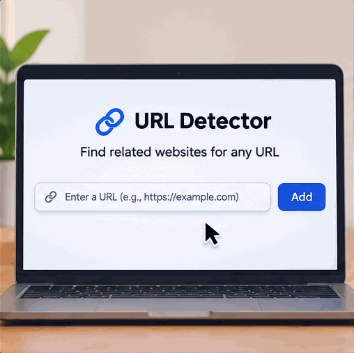

# PhishGuard AI

PhishGuard AI is a full-stack phishing-risk analysis platform for URLs, messages, and emails. It combines explainable machine-learning predictions with deterministic security rules and optional live intelligence checks.

**Live application:** [phishguard-web-production-c178e7d5.up.railway.app](https://phishguard-web-production-c178e7d5.up.railway.app)

> PhishGuard AI is an informational security tool. A low-risk result is not proof that a website, message, or email is safe.

## Preview

<p align="center">
  
</p>

<p align="center">
  
</p>

## Features

- URL scanner with structural ML features and an explainable risk result
- Strict URL and hostname validation before prediction
- Brand-lookalike and stretched-name detection such as `gooogle` and `gooooooogle`
- Live DNS, TLS certificate, and RDAP domain-age checks
- Optional Google Safe Browsing and VirusTotal reputation checks
- Message spam analysis with embedded-link inspection
- Lightweight email analysis for suspicious language, headers, and embedded URLs
- Protected admin analytics dashboard with scan volume and phishing trends
- MySQL-backed scan history with private message and email bodies excluded
- Rate limiting, secure session cookies, CSP, HSTS support, and security headers
- Responsive React interface with a unified royal-violet design

## Detection outcomes

The URL scanner separates confidence from verification:

| Outcome | Meaning |
| --- | --- |
| `Potential Phishing` | The model, a security rule, or live intelligence found strong risk evidence. |
| `Unverified Domain` | No decisive phishing pattern was found, but the domain is not verified as trusted. |
| `Likely Legitimate` | A recognized official domain passed the available checks. This is not a guarantee. |

Invalid entries such as incomplete single-word hostnames are rejected before reaching the model.

## Architecture

```text
Browser
  |
  v
React + Vite frontend
  |
  v
Flask API
  |-- URL ML model + deterministic safeguards
  |-- DNS / TLS / RDAP live intelligence
  |-- Optional Google Safe Browsing / VirusTotal
  |-- Message and email analysis services
  |
  v
MySQL scan history and analytics
```

The production container builds the React frontend, serves it through Flask/Gunicorn, and connects to Railway MySQL using environment variables.

## Technology stack

| Area | Technology |
| --- | --- |
| Frontend | React, Vite, React Router, Lucide icons, Recharts |
| Backend | Python, Flask, Gunicorn, Flask-Limiter |
| Machine learning | scikit-learn, pandas, NumPy, joblib |
| Database | MySQL, Flask-SQLAlchemy, PyMySQL |
| Live intelligence | DNS, TLS, RDAP, Google Safe Browsing, VirusTotal |
| Deployment | Docker, Railway |

## Model results

Metrics are stored in [`models/`](models/) and are shown without claiming unsupported production accuracy.

### URL model

- Selected model: Logistic Regression
- Decision threshold: 46%
- Holdout accuracy: 71.09%
- Holdout phishing recall: 83.33%
- Holdout ROC-AUC: 0.7837
- Training source: `phishing.csv`
- Original rows: 11,054
- Unique usable feature combinations: 637

The URL result is therefore combined with validation, security rules, brand protection, and live intelligence. Repeatedly training on the same limited dataset cannot guarantee accurate detection of future phishing campaigns.

### Message model

- Selected model: Logistic Regression
- Holdout accuracy: 97.97%
- Spam precision: 92.31%
- Spam recall: 91.60%
- Holdout ROC-AUC: 0.9891
- Dataset: UCI SMS Spam Collection

The message dataset primarily covers English SMS spam. It does not validate Hindi or Hinglish performance, and its labels are spam/ham rather than every form of phishing or financial fraud.

## Project structure

```text
.
|-- backend/
|   |-- app.py                    # Flask application and API routes
|   |-- database.py               # MySQL models and persistence
|   |-- url_features.py           # URL normalization and structural features
|   |-- train_url_model.py        # URL model training and evaluation
|   |-- train_message_model.py    # Message model training and evaluation
|   |-- services/                 # Prediction, analytics, and intelligence services
|   `-- tests/                    # Automated backend tests
|-- frontend/
|   |-- public/media/             # README and landing-page visual assets
|   `-- src/                      # React application
|-- models/                       # Serialized pipelines and evaluation metrics
|-- templates/                    # Legacy Flask templates
|-- static/                       # Legacy static assets
|-- Dockerfile                    # Multi-stage production image
|-- requirements.txt              # Python dependencies
|-- railway.json                  # Legacy Railway config pending migration
`-- .railway/railway.ts           # Railway Infrastructure as Code definition
```

All maintained Python source files are inside `backend/`.

## Local setup

### 1. Clone the repository

```bash
git clone https://github.com/deep379k/URL-Phising-Detection-website.git
cd URL-Phising-Detection-website
```

### 2. Create a Python environment

Windows PowerShell:

```powershell
py -m venv .venv
.\.venv\Scripts\Activate.ps1
pip install -r requirements.txt
```

Linux or macOS:

```bash
python3 -m venv .venv
source .venv/bin/activate
pip install -r requirements.txt
```

### 3. Configure environment variables

Copy `.env.example` to `.env` and replace every placeholder. Never commit `.env`.

```powershell
Copy-Item .env.example .env
```

Required for MySQL and the protected admin dashboard:

| Variable | Purpose |
| --- | --- |
| `DB_HOST`, `DB_PORT`, `DB_NAME` | MySQL connection target |
| `DB_USER`, `DB_PASSWORD` | Restricted MySQL application account |
| `SECRET_KEY` | Flask session-signing secret |
| `ADMIN_USERNAME` | Admin dashboard username |
| `ADMIN_PASSWORD_HASH` | Werkzeug password hash, never a plaintext password |
| `COOKIE_SECURE` | Set to `true` behind production HTTPS |
| `TRUST_PROXY` | Set to `true` behind a trusted reverse proxy |
| `RATELIMIT_STORAGE_URI` | Rate-limit storage, such as Redis in multi-worker deployments |

Optional reputation providers:

| Variable | Purpose |
| --- | --- |
| `GOOGLE_SAFE_BROWSING_API_KEY` | Google unsafe-URL reputation lookup |
| `VIRUSTOTAL_API_KEY` | Existing VirusTotal URL-report lookup |

Keep provider licensing, quotas, and URL privacy requirements in mind before enabling them.

### 4. Install and run the frontend

```bash
cd frontend
npm install
npm run dev -- --host 127.0.0.1
```

### 5. Run the backend

From the repository root in another terminal:

```bash
python backend/app.py
```

Open `http://127.0.0.1:5173`. Vite proxies `/api` requests to Flask on port `5000`.

## Production build

Build the React frontend:

```bash
cd frontend
npm ci
npm run build
```

The Flask application serves `frontend/dist` when the production build is available.

Build and run the full Docker image:

```bash
docker build -t phishguard-ai .
docker run --env-file .env -p 8000:8000 phishguard-ai
```

In managed environments, the container binds to the injected `PORT` value.

## Testing

Run the complete automated suite from the backend directory:

```bash
cd backend
python -m unittest discover -s tests -v
```

The suite covers:

- API health and admin authentication
- URL normalization and malformed-input rejection
- IP addresses, unusual ports, long URLs, symbols, and deep subdomains
- Random and unverified domains
- Brand lookalikes and repeated-character attacks
- Message and email analysis
- Live-intelligence result merging and provider outages

Train and evaluate the models:

```bash
python backend/train_url_model.py
python backend/train_message_model.py
```

Training writes model artifacts and measured metrics to `models/`.

## Main API routes

| Method | Route | Purpose |
| --- | --- | --- |
| `GET` | `/api/health` | Service, model, and database health |
| `POST` | `/api/predict/url` | URL prediction and optional live checks |
| `POST` | `/api/predict/url/manual` | Legacy 21-feature manual prediction |
| `POST` | `/api/predict/message` | Message spam and embedded-URL analysis |
| `POST` | `/api/predict/email` | Lightweight email risk analysis |
| `POST` | `/api/admin/login` | Start a protected admin session |
| `GET` | `/api/analytics/overview` | Authenticated analytics summary |
| `GET` | `/api/analytics/trends` | Authenticated scan trends |

## Security and privacy

- Submitted destinations are not opened by the normal structural model.
- Browser URL scans may perform DNS, TLS, RDAP, and configured reputation lookups.
- Arbitrary page-content execution remains disabled in the Flask process to prevent SSRF.
- Private email and message bodies are not stored in scan history.
- Stored URL history removes credentials, query parameters, and fragments.
- API keys, passwords, session secrets, and database credentials belong only in environment variables.
- VirusTotal queries can have privacy and licensing implications; do not submit private URLs without understanding the provider policy.

## Deployment

The public application is deployed on Railway using Docker and Railway MySQL:

**https://phishguard-web-production-c178e7d5.up.railway.app**

Deployment health endpoint:

```text
https://phishguard-web-production-c178e7d5.up.railway.app/api/health
```

## Limitations

- No phishing detector can guarantee that every future URL is classified correctly.
- A valid TLS certificate does not prove a website is trustworthy.
- A young domain is a risk signal, not proof of phishing.
- Reputation services may be unavailable, rate-limited, or unconfigured.
- Page-content and redirect execution require a separately isolated worker.
- Model metrics measure the included datasets and should not be treated as universal real-world accuracy.

## Contact

Created by **Deepanshu**.

Email: [deepanshu739k@gmail.com](mailto:deepanshu739k@gmail.com)

Use the contact form on the live homepage to open a pre-filled Gmail message. PhishGuard AI does not store the contact message.
